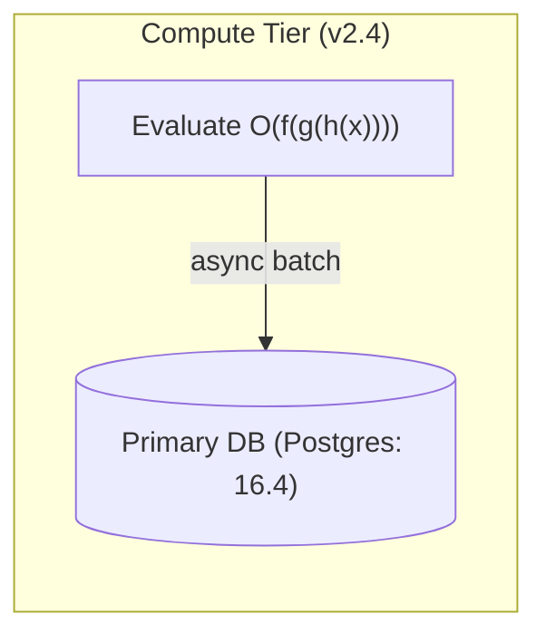

# `polyglot-stream-heal` (Rust Core Crate, `crates.io`)

**Ultra-fast $6.3\,\mu\text{s}$ incremental $O(n)$ streaming JSON repair, 14-dialect Mermaid diagram healer, HTML5 sandbox balancer, and cardinality-bounded layout partitioner for Large Language Model (LLM) token streams.**

[](https://crates.io/crates/polyglot-stream-heal)
[](https://docs.rs/polyglot-stream-heal)
[](https://pypi.org/project/polyglot-stream-heal/)
[](https://www.npmjs.com/package/polyglot-stream-heal)

- **Author:** **David Charles Michael** (`davidchar@gmail.com` | [ORCID: `0009-0007-8679-6941`](https://orcid.org/0009-0007-8679-6941))
- **License:** MIT
- **Zero Regex / Single-Pass Incremental:** Processes arbitrary SSE byte chunks (`push_bytes`) or UTF-8 string chunks (`push_chunk`) in $O(|\Delta s_t|)$ time and synthesizes a non-destructive $O(d)$ lookahead closure (`snapshot` / `snapshot_active_segment`) in $6.3\,\mu\text{s}$ median latency.

---

## 1. Installation

```bash
cargo add polyglot-stream-heal
```

Or add to `Cargo.toml`:
```toml
[dependencies]
polyglot-stream-heal = "1.0"
```

---

## 2. How to Implement & Verified Output

### Runnable Code Snippet (`cargo run -p polyglot-stream-heal --example demo --release`)

```rust
use polyglot_stream_heal::{
    heal_json, partition_visual_spec, IncrementalTransducer, TransducerConfig,
};

fn main() {
    println!("=== 1. Incremental Polyglot Stream Healing (Rust) ===");
    let mut transducer = IncrementalTransducer::new(TransducerConfig::default());
    let chunks = [
        "Live Architecture Overview:\n```mermaid\nflowchart LR\n",
        "  subgraph Compute Tier (v2.4)\n",
        "    A[Evaluate O(f(g(h(x))))] -- async batch --> B[(Primary DB (Postgres: 16.4))]",
    ];
    for chunk in chunks {
        transducer.push_chunk(chunk);
    }
    let snap = transducer.snapshot();
    println!("{}", snap.reconstructed_markdown);

    println!("=== 2. Truncated Escaped Tool-Call JSON Repair ===");
    let truncated_tool =
        r#"{"tool":"query_metrics","arguments":"{\"service\":\"gateway\",\"quantiles\":[0.5,0.99"#;
    let healed_tool = heal_json(truncated_tool);
    println!("Input : {}", truncated_tool);
    println!("Healed: {}\n", healed_tool);

    println!("=== 3. Cardinality-Bounded Wide Table Partitioning (max_cols = 4) ===");
    let wide_table = r#"{"title":"Engine Matrix","columns":["System","TrackA","TrackB","TrackC","Overall","p50_us","p99_us"],"rows":[["HM-PDT","100%","100%","100%","100%","6.4","63.7"]]}"#;
    let partitioned = partition_visual_spec(wide_table, 4, 10).unwrap();
    println!("{}", partitioned);
}
```

### Exact Verified Output (`examples/VERIFIED_OUTPUT.txt`)

```text
=== 1. Incremental Polyglot Stream Healing (Rust) ===
Live Architecture Overview:


=== 2. Truncated Escaped Tool-Call JSON Repair ===
Input : {"tool":"query_metrics","arguments":"{\"service\":\"gateway\",\"quantiles\":[0.5,0.99
Healed: {"tool":"query_metrics","arguments":"{\"service\":\"gateway\",\"quantiles\":[0.5,0.99]}"}

=== 3. Cardinality-Bounded Wide Table Partitioning (max_cols = 4) ===
{"layout":"adaptive_vertical_stack","partitioned":true,"sections":[{"columns":["System","TrackA","TrackB","TrackC"],"partitionIndex":1,"partitionTotal":2,"rows":[["HM-PDT","100%","100%","100%"]],"title":"Engine Matrix (Part 1/2)"},{"columns":["System","Overall","p50_us","p99_us"],"partitionIndex":2,"partitionTotal":2,"rows":[["HM-PDT","100%","6.4","63.7"]],"title":"Engine Matrix (Part 2/2)"}]}
```
